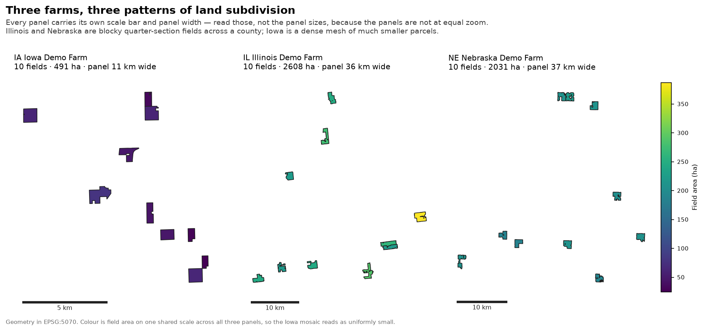
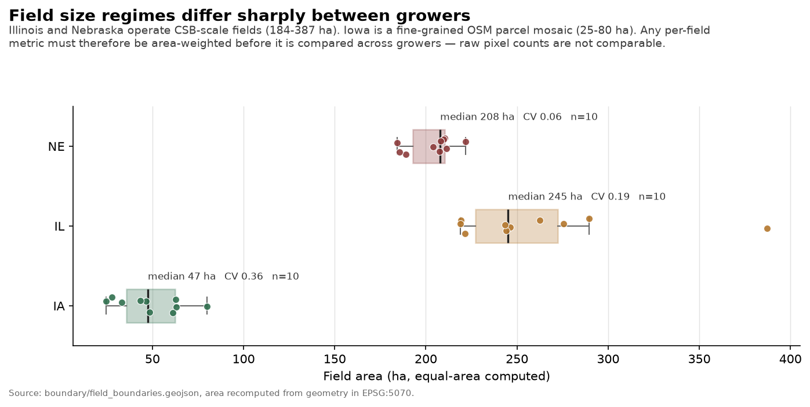
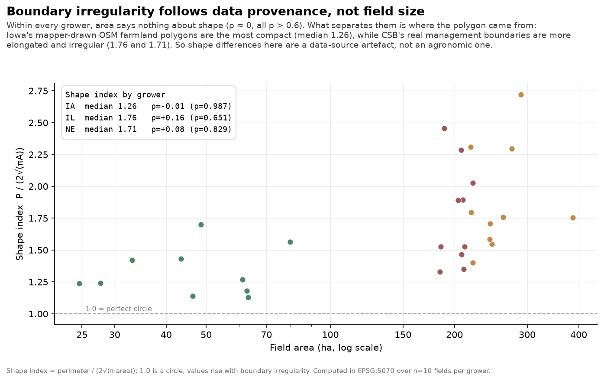
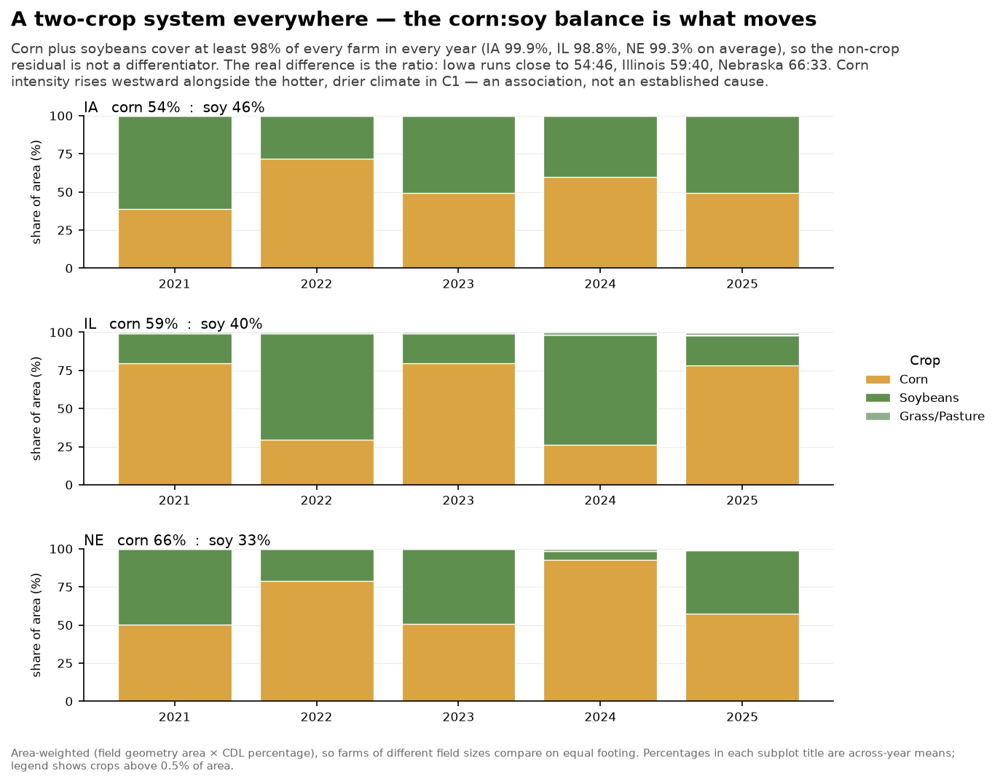
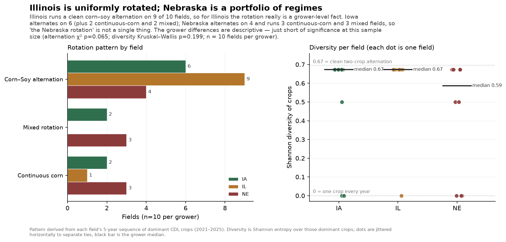
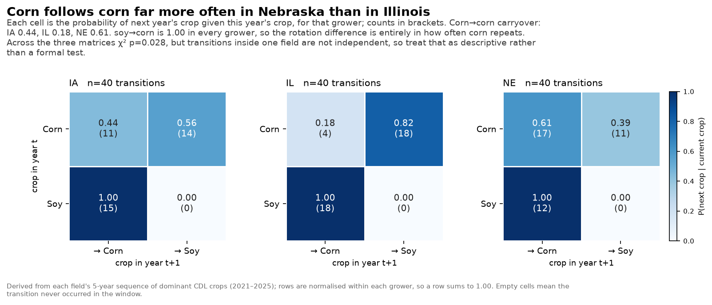
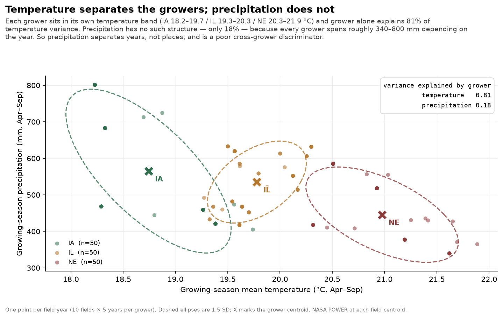
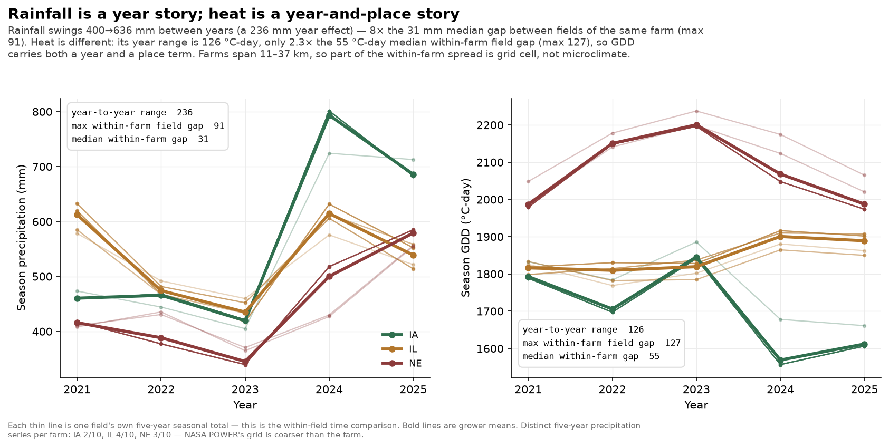
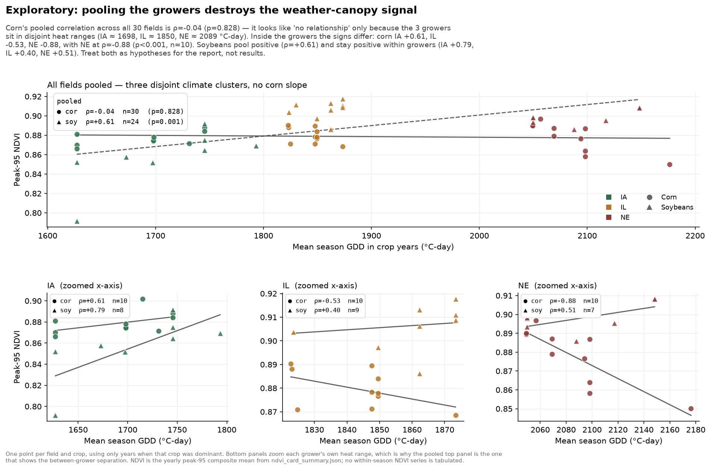

# Assignment 2 — Field-level EDA across three growers

A like-for-like comparison of **field boundaries**, **CDL/cropland history** and
**weather** for three demo growers: Iowa (IA, 10 fields), Illinois (IL, 10
fields) and Nebraska (NE, 10 fields). Window: 2021–2025, 150 field-years.

This is the assembled write-up. The reusable workflow that produces every
number and figure here lives in [`GUIDE.md`](GUIDE.md); the raw artifact set is
written to `$DATA_PIPELINE_DATA_ROOT/data-pipeline/eda/assignment-2/`.

**Scope limits.** Boundaries, CDL and weather only. No soil analysis, no yield
analysis, no raster reads, and no interactive dashboard — the outputs are
static PNG figures and CSV tables.

## What the data says, in one page

1. **Field size is a data-source property first.** Iowa's OSM parcels have a
   median of 47 ha; the CSB-derived Illinois and Nebraska fields are 245 ha and
   208 ha. Every per-field metric therefore has to be area-weighted before it
   is compared across growers.
2. **Boundary shape follows provenance, not agronomy.** Within each grower,
   field area explains essentially none of the shape variation (|ρ| ≤ 0.16).
   What separates the growers is that OSM mapper-drawn parcels are compact
   (median shape index 1.26) while CSB management boundaries are elongated and
   irregular (1.76 and 1.71).
3. **All three run a two-crop system; only the ratio moves.** Corn plus
   soybeans cover at least 98 % of every farm in every year. The corn share is
   54 % (IA), 59 % (IL) and 66 % (NE).
4. **Rotation discipline is per-field.** Illinois alternates corn–soy on 9 of
   10 fields. Iowa does on 6 (plus 2 continuous-corn and 2 mixed), Nebraska on
   only 4 (plus 3 continuous-corn and 3 mixed), so "the Nebraska rotation" is
   not one fact.
5. **The transition matrices locate the difference.** Corn follows corn 44 %
   of the time in Iowa, 18 % in Illinois and 61 % in Nebraska, while
   soy→corn is 100 % everywhere. The growers differ almost entirely in how
   often corn repeats.
6. **Temperature separates growers; precipitation separates years.** Grower
   alone explains 81 % of temperature variance but only 18 % of precipitation
   variance. Rainfall's year-to-year range is 7.6× the median gap between
   fields of the same farm; GDD's is only 2.3×, so heat carries both a year and
   a place term.
7. **The weather→canopy signal is a within-grower story.** Pooled across all
   30 fields, corn's GDD–NDVI correlation is ρ = −0.04 (p = 0.83), but the
   sign differs inside the growers (+0.61 IA, −0.53 IL, −0.88 NE). Pooling
   cancels opposing within-grower relationships — a textbook Simpson's
   paradox, and a hypothesis, not a result.

## Data and method

- **Fields.** 30 field boundaries discovered from the runtime tree and joined
  on the inventory `field_id`; no slug is hardcoded. Areas, perimeters and
  shape indices are recomputed from geometry in EPSG:5070 rather than trusting
  `area_ha_est` (deviation ≤ 0.03 % where the column exists).
- **CDL.** Per-year `<farm>_<year>_cdl.csv` tables are concatenated; aggregate
  `*_full_composition.csv` files are inconsistent and only used as a fallback.
  Crop shares are area-weighted by field geometry, so 25 ha OSM parcels and
  387 ha CSB fields compare on equal footing. The window starts in 2021
  because Nebraska CDL does.
- **Weather.** NASA POWER daily series at each field centroid, reduced to
  April–September seasonal statistics (mean temperature, precipitation, GDD,
  frost-free days).
- **Statistics.** Kruskal–Wallis across growers with pairwise Mann–Whitney
  tests; Holm adjustment is applied **within each metric's pairwise set**, not
  across the whole log. Rotation and transition tests are reported as
  descriptive because fields and field-years are not independent
  observations.

## 1. Field boundaries

Every footprint is drawn at its own scale in the context map; the panels are
deliberately not at equal zoom, so read each panel's scale bar and width.



Field-size regimes differ by roughly fivefold in median (47 ha vs 208–245 ha),
and the within-grower spread is just as telling: CV 0.36 in Iowa against 0.06
in Nebraska. This is the reason the crop and weather comparisons below are
area-weighted.



Shape is not a size effect. Within every grower, area is unrelated to shape
index (IA ρ = −0.01, IL +0.16, NE +0.08; all p > 0.6). The separation is
between provenance families: OSM parcels are compact, CSB management
boundaries are elongated. Treat A2 as a data-lineage finding, not an agronomic
one.



The comparison table behind these two figures is `A3_boundary_stats.csv`
(per-grower counts, area quantiles, CV, mean shape index, perimeter, vertex
count). Field area differs across growers at Kruskal–Wallis p < 0.001
(ε² = 0.85). Shape also differs overall (p = 0.002), but the IL-vs-NE pair does
not (p = 0.47) — the shape contrast is really OSM versus CSB, not state versus
state.

## 2. CDL and cropland history

Two crops cover the landscape. Corn + soybeans are never below 98.0 % of
area in any farm-year (grower means: IA 99.9 %, IL 98.8 %, NE 99.3 %). The
non-crop residual is a sliver of alfalfa, wheat, grass, forest and fallow, and
is not a differentiator.



The corn:soybean balance moves westward: about 54:46 in Iowa, 59:40 in
Illinois, 66:33 in Nebraska. That is an association with the hotter, drier
climate seen in C1 — not an established cause.

Rotation pattern is where the growers genuinely diverge. Illinois is close to a
single grower-level regime (9 of 10 fields in clean alternation). Iowa runs
three regimes (6 alternation, 2 continuous corn, 2 mixed) and Nebraska runs
three as well (4 alternation, 3 continuous corn, 3 mixed). The grower
differences are descriptive at this sample size: alternation χ² p = 0.065 and
rotation-diversity Kruskal–Wallis p = 0.199.



The transition matrices make the mechanism explicit rather than just the
labels. Corn→corn carryover is 0.44 in Iowa, 0.18 in Illinois and 0.61 in
Nebraska; soy→corn is 1.00 in all three. Nebraska's extra corn is therefore
corn repeating on itself, not soy being replaced. The across-grower transition
χ² is p = 0.028, but transitions inside one field are not independent, so read
it descriptively.



The numeric backing is `B3_rotation_transitions.csv` (per-grower row shares
and counts) and `B3_rotation_purity.csv` (per-field sequence, pattern,
alternation rate, Shannon diversity).

## 3. Weather

Temperature puts each grower in its own band: IA 18.2–19.7 °C, IL 19.3–20.3 °C,
NE 20.3–21.9 °C, and grower alone explains 81 % of the variance. Precipitation
has no such structure — grower explains only 18 % — because every grower spans
roughly 340–800 mm depending on the year. Seasonal temperature differs across
growers at p < 0.001; precipitation at p < 0.001 too, but its effect size is
far smaller (ε² 0.18 vs 0.86) and it is a year effect rather than a place
effect.



The within-field time view splits the two signals. Rainfall's year-to-year
range is 236 mm, 7.6× the 31 mm median gap between fields of the same farm
(max 91 mm). GDD's year range is 126 °C-day, only 2.3× the 55 °C-day median
within-farm gap (max 127), so heat needs both terms. Farms span 11–37 km,
which is enough for the coarser NASA POWER grid to matter.



A caution baked into the data: the ten fields of a farm resolve to only 2
(IA), 4 (IL) and 3 (NE) distinct five-year precipitation series. NASA POWER's
grid is coarser than a farm, so part of any within-farm weather spread is a
grid artefact. The workflow emits this as a warning rather than hiding it.

`C3_weather_stats.csv` carries the per-grower climate summary and the
between-grower variance shares (temperature 0.806, precipitation 0.181, GDD
0.768, frost-free days 0.385).

## 4. Cross-category bridge (exploratory)

The optional weather × canopy view uses one point per field and crop, in years
when that crop was dominant, against the yearly peak-95 NDVI mean. It is
included to show why pooled correlations can mislead, not as a result.



Corn's pooled correlation is ρ = −0.04 (p = 0.83, n = 30) because the growers
sit in disjoint heat ranges (mean crop-year GDD 1698 / 1850 / 2089 °C-day).
Within growers the sign changes: +0.61 (IA, p = 0.061), −0.53 (IL, p = 0.117)
and −0.88 (NE, p < 0.001). Soybeans pool positive (+0.61, p = 0.0015) and stay
positive within all three growers (+0.79 / +0.40 / +0.51). Treat both as
hypotheses for follow-up.

## Artifacts

All generated outputs live under
`$DATA_PIPELINE_DATA_ROOT/data-pipeline/eda/assignment-2/`:

| Kind | Files |
|---|---|
| Figures (9) | `figures/` — A1, A2, M1, B1, B2, B3, C1, C2, X1 |
| Boundary tables | `A3_boundary_stats.csv` |
| Rotation tables | `B3_rotation_transitions.csv`, `B3_rotation_purity.csv` |
| Weather table | `C3_weather_stats.csv` |
| Bridge table | `X1_weather_ndvi.csv` |
| Test log | `statistical_tests.csv` (30 rows) |
| Manifest | `INDEX.md`, `run_manifest.json` |

The nine PNGs committed beside this report are copies of the generated
figures so the write-up renders on GitHub; the CSVs stay in the runtime tree
and are not committed.

## Reproducing

```bash
export DATA_PIPELINE_DATA_ROOT=~/my-farm-advisor-runtime
cd my-farm-advisor/eda/eda-field-comparison
"$DATA_PIPELINE_DATA_ROOT/data-pipeline/.venv/bin/python" \
  scripts/run_field_eda.py
```

A clean run prints `figures: 9 tables: 5`, exits 0 and emits three expected
warnings about collapsed weather series. The full contract, flags and caveats
are in [`GUIDE.md`](GUIDE.md).
