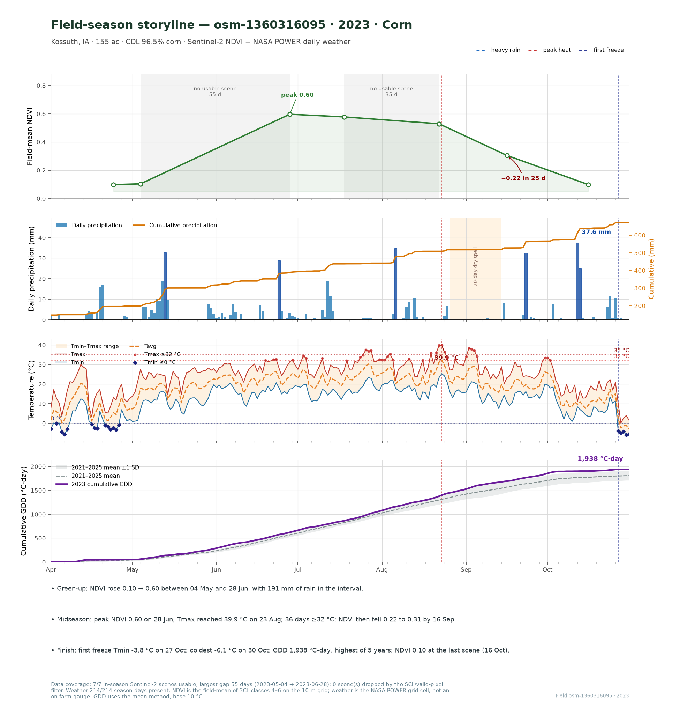

# Field-Season Storyline Dashboard

A reusable one-field workflow that aligns Sentinel-2 NDVI, NASA POWER daily
weather and CDL crop-year information on a single growing-season calendar and
renders a four-panel mini-dashboard.

**Skill name:** `eda-field-season-dashboard`

## Assignment 3 result

| Item | Value |
|---|---|
| Field | `osm-1360316095` — Kossuth County, Iowa (`ia-demo-grower` / `iowa-demo-farm`, 155 ac) |
| Year | **2023** |
| CDL crop | **Corn** — 695 px, **96.53 %** of the field |
| CDL table | `derived/tables/iowa_2023_cdl.csv` |
| Sentinel NDVI | `fields/osm-1360316095/satellite/sentinel/2023/sentinel_*/sentinel_*_ndvi.tif` |
| Sentinel SCL | same scenes, `*_scl_epsg4326.tif` |
| Weather | `fields/osm-1360316095/weather/daily_weather.csv` |
| Season window | 1 April–31 October 2023 |



The 2023 season reads left to right: NDVI rose from 0.10 on 4 May to a 0.60 peak
on 28 June after 191 mm of rain across the green-up window; the hottest day
reached 39.9 °C on 23 August with 36 days at or above 32 °C; NDVI fell 0.22 to
0.31 by 16 September; the first freeze reached −3.8 °C on 27 October. Seasonal
GDD was 1,938 °C-day, the highest of the five available years.

All five years for the same field are committed in
`examples/assignment-3/output/` (2021 corn, 2022 soybeans, 2023 corn,
2024 soybeans, 2025 corn). The 2023 corn dashboard is the featured image above.

## Weather metrics calculated

| Metric | Definition |
|---|---|
| Daily GDD | `max(0, (Tmax + Tmin) / 2 − 10)` °C-day (mean method, base 10 °C) |
| Cumulative GDD | running season sum from 1 April |
| Seasonal precipitation | sum of `PRECTOTCORR` |
| Hot / extreme days | `Tmax ≥ 32 °C` / `Tmax ≥ 35 °C` |
| Heavy-rain days | `PRECTOTCORR ≥ 25 mm` |
| Frost days | `Tmin ≤ 0 °C` |
| Dry spells | ≥14 consecutive days with `< 1 mm/day` |
| GDD normal | same-field 2021–2025 mean and ±1 SD |

## Output paths

Repository-relative (committed):

```text
my-farm-advisor/eda/eda-field-season-dashboard/examples/assignment-3/output/
├── osm-1360316095_2021_corn_season_dashboard.png
├── osm-1360316095_2022_soybeans_season_dashboard.png
├── osm-1360316095_2023_corn_season_dashboard.png
├── osm-1360316095_2024_soybeans_season_dashboard.png
└── osm-1360316095_2025_corn_season_dashboard.png
```

Runtime (generated sidecars and manifest):

```text
${DATA_PIPELINE_DATA_ROOT}/data-pipeline/eda/assignment-3/
├── osm-1360316095_2023_corn_season_dashboard.png
├── osm-1360316095_2023_ndvi_scenes.csv
├── osm-1360316095_2023_weather_daily.csv
├── osm-1360316095_2023_events.csv
└── osm-1360316095_season_dashboard_manifest.json
```

Relative to the runtime `data-pipeline/` root, the generated image is:

```text
eda/assignment-3/osm-1360316095_2023_corn_season_dashboard.png
```

## Rerun

```bash
export DATA_PIPELINE_DATA_ROOT=~/my-farm-advisor-runtime
cd my-farm-advisor/eda/eda-field-season-dashboard

# featured field-year
"$DATA_PIPELINE_DATA_ROOT/data-pipeline/.venv/bin/python" \
  scripts/run_season_dashboard.py \
  --field osm-1360316095 --year 2023

# every available Sentinel year for the field
"$DATA_PIPELINE_DATA_ROOT/data-pipeline/.venv/bin/python" \
  scripts/run_season_dashboard.py \
  --field osm-1360316095 --year all

# write into the repository example folder when republishing the images
"$DATA_PIPELINE_DATA_ROOT/data-pipeline/.venv/bin/python" \
  scripts/run_season_dashboard.py \
  --field osm-1360316095 --year all \
  --out examples/assignment-3/output
```

The default output is
`$DATA_PIPELINE_DATA_ROOT/data-pipeline/eda/assignment-3/`. When republishing
into the repository, delete the generated `*_ndvi_scenes.csv`,
`*_weather_daily.csv` and `*_events.csv` sidecars; only the PNGs and the
manifest belong in git.

## Known data limitations

- NASA POWER is a gridded product, not an on-farm gauge; weather values describe
  the field's grid cell.
- The 2023 NDVI series has a 55-day usable-scene gap (4 May–28 June). The panel
  shades the gap and the coverage note gives the count.
- 2022 has a fully masked 14 May scene; 2024 has a 65-day gap
  (23 May–27 July). Those years are included to show the workflow handles them.
- SCL is coarser than NDVI and is resampled nearest-neighbour; scenes with less
  than 30 % valid field pixels are dropped.
- GDD uses the base-10 mean method with no upper cap. It is a season-comparison
  metric, not a crop model or a yield forecast.
- CDL identifies the annual crop class only; it does not provide planting date,
  hybrid, population or management.
- March and November Sentinel scenes exist for some years but fall outside the
  shared 1 April–31 October axis.

See [`GUIDE.md`](GUIDE.md) for the method and [`AGENTS.md`](AGENTS.md) for local
edit rules.
